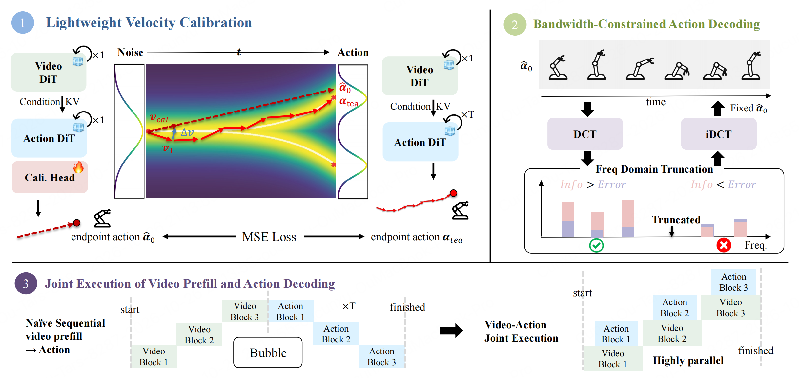
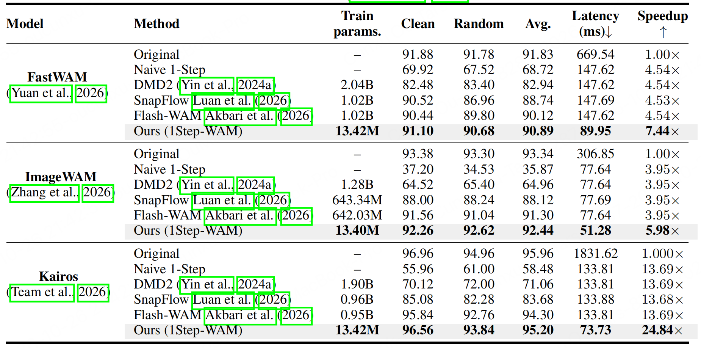
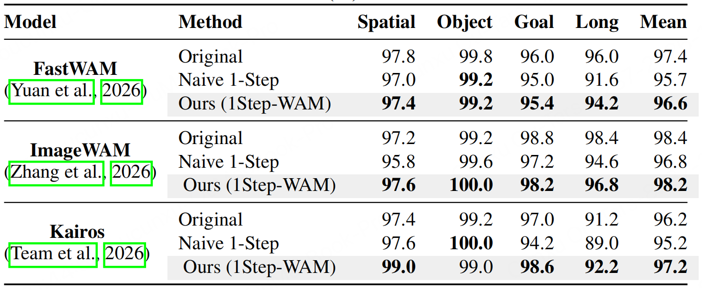
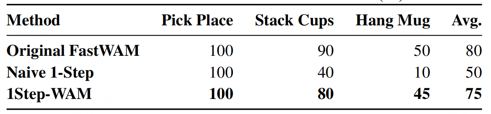
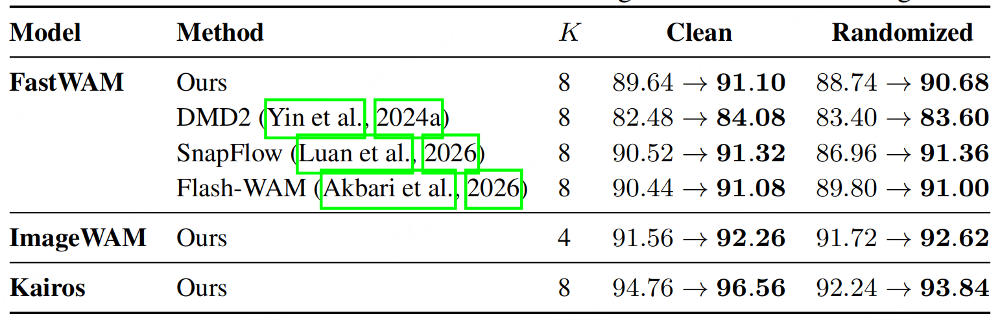
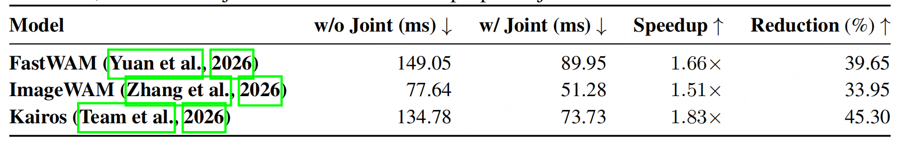

## 1Step-WAM: Your World Action Model but Faster using 1-Step Action Generation

> 论文：[arXiv:2610.15625](https://arxiv.org/abs/2610.15625)
> GitHub：[changdong1687/1Step-WAM](https://github.com/changdong1687/1Step-WAM)

### 一. 概述

**研究动机**：FastWAM、ImageWAM、Kairos 等 World Action Models（WAMs）已经降低了视觉世界建模的推理开销，但动作分支仍需多步 denoising。通常还要等整个视觉分支完成 prefill、生成全部 visual K/V cache 后，才开始动作计算，因此同时存在**动作多步迭代**和**视觉-动作串行等待**两个瓶颈。**直接把动作去噪改成一步会显著掉点**。作者发现：固定视觉观测、语言指令和机器人状态后，多步教师的输出受初始噪声变化影响较小，去噪轨迹在大部分时间区间近似直线。这意味着首步速度已经包含主要运动方向，但仍需校准才能满足操作精度。

**核心思想**：冻结预训练 WAM，只训练约 **13.4M 参数的 calibration head (校准头)**，将首步瞬时速度修正为能直接到达多步教师终点的有效速度；推理时再用 **DCT 低通投影**抑制残余时序误差，并通过 **逐层视觉-动作流水执行**减少等待。三个模块分别解决一步预测精度、动作频域误差和系统调度开销。

---

### 二. 模型方法

#### 1. 为什么首步速度可以用于一步动作生成？

作者有两个观察：

- **终点比较集中**：固定视觉观测、语言指令和机器人状态后，即使更换初始噪声，多步教师最终生成的动作也比较接近。
- **沿途方向变化较小**：在代表性去噪轨迹中，相邻步骤预测的速度方向高度相似，说明轨迹在大部分时间区间接近直线。

可以把去噪理解为“从噪声位置走到动作终点”。如果沿途方向变化不大，那么起步时预测的速度就已经包含了主要运动方向，可以用它直接估计终点。

论文的去噪时间从 $t=1$ 减小到 $t=0$ ，所以一步预测为：
$$
\hat a_0=x_1-v_1.
$$
其中 $x_1$ 是初始噪声， $v_1$ 是首步速度，减号来自时间向后移动。

但轨迹只是近似直线，原模型的首步预测也存在误差。因此，直接一步生成仍可能不够精确，需要训练 calibration head 修正首步速度。

论文在“固定条件下动作分布近似高斯、方差较小”的假设下解释了这一现象，它并不保证所有任务都能直接一步生成准确动作。详见论文 §3、§5.3 与附录 §7.1。

#### 2. Lightweight Velocity Calibration：只修正首步速度

冻结的 Action DiT 在 $t=1$ 只执行一次，获得首步速度 $v_1$ 和最后一个 action block 的 hidden features $h_1$ 。新增 MLP 预测速度 residual：

$$
\Delta v=f_\phi(h_1,x_1,v_1),\qquad
v_{\mathrm{cal}}=v_1+\Delta v,
$$

$$
\hat a_0=x_1-v_{\mathrm{cal}}
=x_1-\bigl(v_1+\Delta v).
$$

其中 $\hat a_0$ 是 DCT 投影前的完整动作 chunk。calibrator 不重新生成视觉条件，而是利用冻结 backbone 已提取的特征，**纠正首步输出与教师终点之间的偏差**。

> calibration head 参数量约为 13.40M–13.42M，计算过程和尺寸变化详见附录 §7.5.1。

> 相对部分直接全量微调的蒸馏方法，轻量校准显著减少可训练参数，但可能承担精度损失，并增加小头的推理开销

#### 3. Bandwidth-Constrained Action Decoding：沿动作时间轴做 DCT 截断

校准只约束终点误差，没有显式限制动作 chunk 的时序频率。作者观察到**教师动作的能量主要集中在低频，而校准后的一步预测在一些高频模式中仍有较明显误差**，因此在推理时加入固定低通投影，滤掉动作的高频部分。

记连续关节动作矩阵为 $\hat A_c\in\mathbb R^{T\times d_c}$ ， $T$ 是 action horizon， $d_c$ 是连续动作维度； $C \in \mathbb R^{T\times T}$ 是正交 DCT-II 矩阵（负责将动作转换为频率系数）， $M_K \in \mathbb R^{T\times T}$ 仅保留前 $K$ 个模式（对角掩码：前 $K$ 个对角元素为 1，其余为 0），**$P_K$ 负责直接将动作投影到前 $K$ 个低频模式张成的子空间**：

$$
A_c^{\mathrm{exec}}=P_K\hat A_c,\qquad
P_K=C^\top M_KC.
$$

操作顺序为：**逐关节沿 horizon 做 DCT (左乘 $C$ ) → 保留前 $K$ 项、其余置零 (左乘 $M_K$ ) → inverse DCT (左乘 $C^\top$ )**。它处理的是动作时间轴上的频率，不是对关节维度做变换；gripper 输出保持不变，chunk 长度也保持不变。

> **低通何时有用？** 设同条件、同初始噪声下的教师连续动作为 $A_c^T$ ，预测误差为 $E_c=\hat A_c-A_c^T$ 。投影后的教师匹配误差分解为：
> $$
> R_K
> =\mathbb E\lVert A_c^{\mathrm{exec}} - A_c^T\rVert_F^2
> =\mathbb E\lVert P_K\hat A_c - A_c^T\rVert_F^2
> =\mathbb E\lVert P_KE_c\rVert_F^2
> +\mathbb E\lVert(I-P_K)A_c^T\rVert_F^2.
> $$
>
> 第一项是保留下来的低频预测误差，第二项是被丢弃的高频教师动作能量。相对不截断的 $R_{\mathrm{full}}=\mathbb E\lVert E_c\rVert_F^2$ ，有：
>
> $$
> R_K-R_{\mathrm{full}}
> =\mathbb E\lVert(I-P_K)A_c^T\rVert_F^2
> -\mathbb E\lVert(I-P_K)E_c\rVert_F^2.
> $$
>
> 所以必须是**被丢弃的高频预测误差能量大于被丢弃的高频教师动作能量**，截断才会降低教师匹配误差。

#### 4. Joint Execution：视觉 cache 就绪一层，动作分支计算一层

常规流程先完成全部视觉 prefill，再执行 Action DiT。论文指出，第 $l$ 个动作 block 的依赖只有前一动作 block 输出 $H_{l-1}^a$ 和对应视觉层的 cache $C_l$ ：

$$
H_l^a=\mathcal A_l(H_{l-1}^a,C_l).
$$

因此可以将视觉和动作分支放在不同 CUDA streams 中，使用 CUDA events 同步：

1. 视觉层 $l$ 生成 $C_l$ 后记录 cache-ready event。
2. 动作 stream 等待该 event，并在 $H_{l-1}^a$ 就绪后计算动作 block $l$ 。
3. 同时视觉 stream 继续计算后续层，两个分支尽可能重叠。
4. 最后一个动作 block 完成后，再执行 calibration head 与 DCT 投影。

这种调度保留层间依赖，消除了“必须先等全部视觉层结束”的整段等待。

---

### 三. 训练流程

#### 1. 数据与初始化

- **起点**：已训练好的多步 FastWAM、ImageWAM 或 Kairos；**冻结视觉分支、动作分支及其 encoder，只更新 calibration head**。
- **监督目标**：同一条件、同一初始噪声下，由冻结多步 WAM 生成的**教师动作 $a_{\mathrm{tea}}$** 。
- **仿真数据**：RoboTwin、LIBERO。
- **真实机器人数据**：Pick Place、Stack Cups、Hang Mug 各 200 episodes。

#### 2. 教师终点监督

1. 从数据中取得条件 $c$ ，采样初始噪声 $x_1$ 。
2. 冻结教师从同一 $x_1$ 出发，多步去噪获得 $a_{\mathrm{tea}}$ ，作为固定监督目标。
3. 冻结 Action DiT 在 $t=1$ 前向一次，取得 $v_1$ 、 $h_1$ 及 encoder 特征。
4. calibration head 预测 $\Delta v$ ，构造一步动作 $\hat a_0=x_1-v_1-\Delta v$ 。
5. 最小化动作空间 MSE，仅更新 $\phi$ ：

   $$
   \mathcal L(\phi)=\mathbb E\left[\lVert\hat a_0-a_{\mathrm{tea}}\rVert_2^2\right].
   $$

> **DCT 不参与训练损失**：训练拟合完整频带的教师动作，固定低通投影仅在推理时应用。

#### 3. 已披露超参数

| 项目 | 设置 |
|---|---|
| 优化器 | AdamW |
| 校准头训练步数 | 500 steps |
| 学习率 | $5\times10^{-6}$ |
| Global batch size | 512 |
| 可训练参数 | FastWAM / Kairos：13.42M；ImageWAM：13.40M |
| DCT 保留模式数 $K$ | FastWAM：8；ImageWAM：4；Kairos：8 |

---

### 四. 推理流程

1. 输入当前图像、语言指令和机器人状态，采样完整 action chunk 的噪声 $x_1$ 。
2. 启动视觉 prefill；视觉层生成对应 K/V cache 后，逐层触发唯一一次 Action DiT 前向，与剩余视觉层计算重叠。
3. 获取 $v_1$ 、 $h_1$ 和 encoder 特征，运行 calibration head，计算 $\hat a_0=x_1-(v_1+\Delta v)$ 。
4. 对连续关节维度沿 horizon 做 DCT，保留前 $K$ 项后做 inverse DCT，保留 gripper 输出，得到可执行动作 chunk。
5. 将 chunk 交给控制器，后续观测更新与动作执行方式沿用相应 backbone 的设置。

推理只需 **1 次完整 Action DiT 前向**，视觉 prefill、校准头、DCT 仍需计算。

---

### 五. 实验

#### 1. 实验设置

- **RoboTwin**：50 个双臂操作任务，分别评估 Clean 与 Randomized；报告成功率及二者平均值。
- **LIBERO**：Spatial、Object、Goal、Long 四个 suite，每个 suite 10 个任务；报告成功率与 suite 均值。
- **真实机器人**：AIRBOT Play + 鱼眼相机，三个操作任务；每个方法、每个任务评估 20 次独立 rollout。
- **Backbones**：FastWAM、ImageWAM、Kairos。RoboTwin 对比原多步模型、Naive 1-Step，以及作者适配到各动作分支的 DMD2、SnapFlow、Flash-WAM。同一 backbone 内保持 observation interface、action representation 和 horizon 一致。
- **效率指标**：所有延迟均在单张 NVIDIA L40 上测量，使用论文报告的端到端模型推理延迟。

#### 2. 实验结果

##### 2.1 RoboTwin

##### 2.2 LIBERO

##### 2.3 真实机器人：精细对齐任务仍有差距

粗粒度 Pick Place 三者均成功；Stack Cups、Hang Mug 更依赖精确对齐，校准方法显著好于直接一步，但总体仍低于多步教师 5 个百分点。

##### 2.4 消融：DCT 改善成功率，联合调度进一步降低延迟

**DCT 投影**：原文 Table 4，同一校准 checkpoint 的成功率（%），箭头表示“不投影 → 投影”。

**联合调度**：

---

### 六. 局限性

1. **理论有分布假设**：近直线推导建立在固定条件、小方差、各向同性高斯动作分布和理想速度场上；它不构成任意多模态动作分布的一步生成保证。有限方差时，一步均值估计也无法恢复完整输出方差。

2. **DCT 存在信息损失与带宽选择**：截断会丢掉真实高频动作，收益取决于被删频带中教师能量和误差能量的比较；本文按 backbone 设置 $K$ ，未给出自动选择带宽的方法。

   
