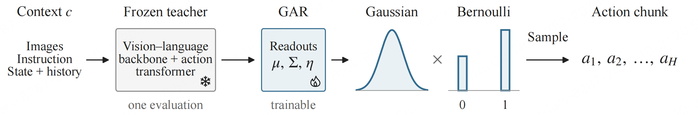

## Gaussian Distillation of Flow Policies

> 论文：[arXiv:2610.40271](https://arxiv.org/abs/2610.40271)

### 一. 概述

**研究动机**：Flow policies 能表达多模态动作分布，但生成一个 action chunk 需要多次前向，动作 likelihood 也没有闭式表达。作者提出一个更基础的问题：**已有 flow policy 在固定观测条件下的动作分布，是否真的需要复杂的非高斯建模？** 对 Xiaomi-Robotics-1 和 GR00T N1.5 的分析发现，其连续动作分布可被 Gaussian 较好近似，因此可能直接预测分布参数，省去多步积分。

**核心思想**：验证已有 flow policy 在固定观测条件下的动作分布能用高斯分布近似，提出 Gaussian Action Readout（GAR）**，冻结预训练教师的 vision-language backbone 和 action transformer，在最终 velocity projection 前的特征上训练小型 readouts，**预测连续动作的均值、协方差和二值命令的概率。部署时固定噪声输入和时间，只做 1 次前向，再从 Gaussian × Bernoulli 分布直接采样动作。

### 二. 模型方法

#### 1. 建模对象与 Gaussian 假设

作者首先检查：**固定图像、语言和机器人状态，只改变教师采样噪声，得到的动作分布能否用单个高斯近似？**

作者在 Xiaomi-Robotics-1 和 GR00T N1.5 上，分别选取 300 个固定观测，对整段 16 步动作中的平移、旋转分别拟合高斯，使用 sliced 1-Wasserstein 距离检查近似误差。结果表明，所分析的连续动作分布总体比较接近高斯，完整协方差的拟合优于对角协方差。

记条件 $c$ 包含语言指令、图像、机器人状态及模型原生观测历史；动作 chunk 为 $a=(m,b)$ ，其中 $m$ 是展平后的连续动作坐标， $b$ 是二值命令（例如夹爪）。教师连续动作的条件均值、协方差分别为 $\mu(c)$ 和 $\Sigma(c)$ 。GAR 近似：

$$
\pi_T^m(m\mid c)\approx\mathcal N\bigl(m;\mu(c),\Sigma(c)\bigr).
$$

> * 这里是固定条件（图像、语言、机器人状态和历史）下整个 action chunk 的分布，不是把不同任务、不同观测的动作混在一起拟合一个 Gaussian。
> * 这是一项特定模型与动作组上的经验观察，不是“所有机器人动作分布都是高斯”的结论。

#### 2 模型：冻结骨干，在最终隐藏特征上增加三类读出器

用固定噪声 \(\epsilon_\star\) 查询一次冻结网络：$ u(c)=u_T(c,\epsilon_\star,0)$，然后预测：

| 读出器             | 输出                                                         | 监督                             |
| ------------------ | ------------------------------------------------------------ | -------------------------------- |
| **均值读出器**     | \(\mu_\theta(c)\)；对原一步预测作仿射校正                    | 对教师样本均值做最小二乘拟合     |
| **协方差读出器**   | 对角方差，或完整协方差的 Cholesky 因子                       | 归一化协方差误差及对数方差比惩罚 |
| **二值指令读出器** | 潜变量均值 \(\eta_{\theta,j}(c)\)，转换为 \(p_{\theta,j}=\Phi(\eta_{\theta,j})\) | 对教师二值指令频率做交叉熵监督   |

### 三. 训练流程

#### 1. 数据与离线教师监督

* **RoboCasa365**：教师使用已发布、在 Human300 示范上训练的 checkpoints。GAR 不重新训练教师，也不直接回归示范动作，而是在示范上下文上拟合**教师自己的动作分布统计量**（用 384 个教师统计得到）。

* **LIBERO-Long**：10 个任务各用 30 条 demonstrations、每条 20 个 contexts，共 6,000；tuning 和 moment evaluation 各用每任务另 5 条 demonstrations、每条 12 个 contexts，各 600；同样每 context 用 384 个教师 samples。教师为 Xiaomi-Robotics-0。

#### 2. 训练标签：同一条件下，统计 384 条教师动作

对每个条件 \(c\)，使用不同噪声运行多步教师：
$$
a^{(k)}=(m^{(k)},b^{(k)}) = T_K(c,\epsilon_k), \qquad k=1,\ldots,384.
$$
分别估计：

$$
\hat\mu_c=\frac1N\sum_n m^{(n)},\qquad
\hat S_c=\frac1N\sum_n(m^{(n)}-\hat\mu_c)(m^{(n)}-\hat\mu_c)^\top,
\qquad
\hat p_{c,j}=\frac1N\sum_n b_j^{(n)}.
$$

将 $\hat S_c$ 向其 diagonal shrink 5%，并对 eigenvalues 设置下界，取“平均对角元素的 $10^{-5}$ 倍”和 $10^{-10}$ 中的较大值，得到 $\hat\Sigma_c$，用于稳定监督目标。

### 四. 推理流程

1. 获取图像、语言指令、机器人状态及原模型需要的 history，沿用教师的 preprocessing 和 vision-language processing。
2. 使用拟合时相同的固定噪声 $\epsilon_\star$ 和 $t=0$ ，只运行一次冻结 action transformer，取得 readout features。
3. 运行 mean、covariance、command readouts，得到 $\mu_\theta(c)$ 、 $\Sigma_\theta(c)$ 和 $p_{\theta,j}(c)$ 。
4. 连续动作从 Gaussian 采样；diagonal 变体为 $m=\mu_\theta(c)+\sigma_\theta(c)\odot\xi$ ，其中 $\xi\sim\mathcal N(0,I)$ ，full 变体使用预测的 Cholesky factor 变换标准噪声；二值命令独立按各自概率采样。
5. 按原生 controller mapping 解码并执行 chunk：RoboCasa365 执行 16 个动作再 replan；LIBERO-Long 执行 10 个动作再 replan。

> 随机性来自输出分布采样，而不是每轮更换 transformer 的输入噪声。

### 五. 实验

#### 1. 实验设置

- **主基准**：RoboCasa365 的 pretrain environment split，评估 50-task target suite：18 个 seen atomic、16 个 seen composite、16 个 unseen composite tasks。每 policy、每任务 50 episodes，共 2,500。不同 policies 的物理场景独立抽取，不能按 episode index 视为配对实验。
- **教师**：Xiaomi-Robotics-1-RoboCasa365（5-step）与 GR00T N1.5（4-step），都使用 Human300 checkpoints。Xiaomi 保留四帧 history，GR00T 使用原生 current-frame inputs。
- **补充基准**：LIBERO-Long 的 10 个任务，教师为 Xiaomi-Robotics-0（5-step），每任务使用 50 个共同官方初始状态，共 500 episodes。
- **Baselines**：原多步 teacher、Raw one-step、Mean-only GAR、Diagonal GAR、Full GAR；另通过每次决策在线采样教师的昂贵诊断，区分分布形状误差与 moment prediction 误差。
- **指标**：task success、Gaussian approximation 的 relative sliced 1-Wasserstein error、moment prediction error、batch-one policy-call latency。主表没有与其他完整 one-step distillation 算法做统一预算对比。

#### 2. 实验结果

##### 2.1 RoboCasa365 成功率

Table 2，默认 6,000 fitting contexts，单位 %，越高越好。

| 教师 | 任务组 | Teacher | Raw one-step | Mean-only | Diagonal GAR | Full GAR |
|---|---|---:|---:|---:|---:|---:|
| Xiaomi | Overall | 58.24 | 55.76 | 56.64 | 57.64 | 57.28 |
| Xiaomi | Atomic seen | 81.11 | 81.22 | 78.44 | 80.56 | 81.67 |
| Xiaomi | Composite seen | 58.75 | 52.63 | 58.13 | 58.00 | 57.38 |
| Xiaomi | Composite unseen | 32.00 | 30.25 | 30.63 | 31.50 | 29.75 |
| GR00T | Overall | 23.08 | 19.28 | 19.72 | 21.92 | 20.32 |
| GR00T | Atomic seen | 46.00 | 43.00 | 44.33 | 45.78 | 43.89 |
| GR00T | Composite seen | 15.38 | 8.13 | 7.75 | 11.75 | 11.50 |
| GR00T | Composite unseen | 5.00 | 3.75 | 4.00 | 5.25 | 2.63 |

| 方案          | 连续动作怎样生成？                                           | 保留什么信息？                     |
| ------------- | ------------------------------------------------------------ | ---------------------------------- |
| **Mean-only** | \(m=\mu_\theta(c)\)                                          | 只使用均值，不加入连续动作随机性   |
| **Diagonal**  | \(m=\mu_\theta(c)+\sigma_\theta(c)\odot z\)                  | 均值＋各坐标自己的方差             |
| **Full**      | \(m=\mu_\theta(c)+L_\theta(c)z\)，其中 \(LL^\top=\Sigma_\theta(c)\) | 均值＋各坐标方差＋坐标之间的相关性 |

##### 2.2 推理效率：完整 policy call 约 1.6–1.9×

Table 11 主测量平台：RTX 4090 + Threadripper PRO 5955WX，batch size 1，三次独立 sessions。计时从内存观测开始，包含 CPU 预处理、数据传输、vision-language processing、动作生成及解码；不含模型加载、通信、排队与仿真。

| 教师 | Action-transformer evaluations / chunk | Teacher latency | GAR latency | Speedup |
|---|---|---:|---:|---:|
| Xiaomi | 5 → 1 | 220.25 ms | 115.36 ms | 1.91× |
| GR00T | 4 → 1 | 68.01 ms | 43.30 ms | 1.57× |

##### 2.3 LIBERO-Long 与行为多样性

| 教师 / 基准 | Teacher | Raw one-step | Diagonal GAR |
|---|---:|---:|---:|
| Xiaomi-Robotics-0 / LIBERO-Long，500 episodes | 96.6% | 96.0% | 95.4% |

GAR 相对教师为 −1.2 pp，paired 95% interval 为 [−3.0, 0.6]。该基准支持扩展到第二个仿真环境，但 Raw one-step 本身已很强，GAR 没有超过它。

### 六. 局限性

1. **验证范围有限**：仅测试所选预训练教师与 RoboCasa365、LIBERO-Long 这两个仿真任务，真实机器人、其他 policy 的适用性未验证。
5. **小头拟合便宜，教师数据准备仍贵**：每个 context 需要大量教师 samples。
