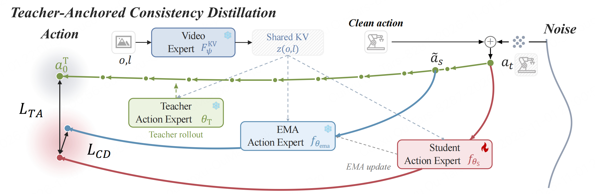
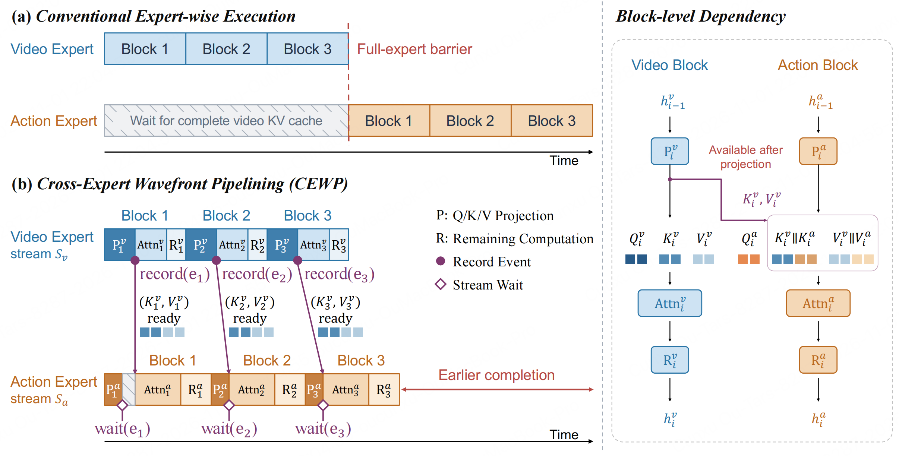
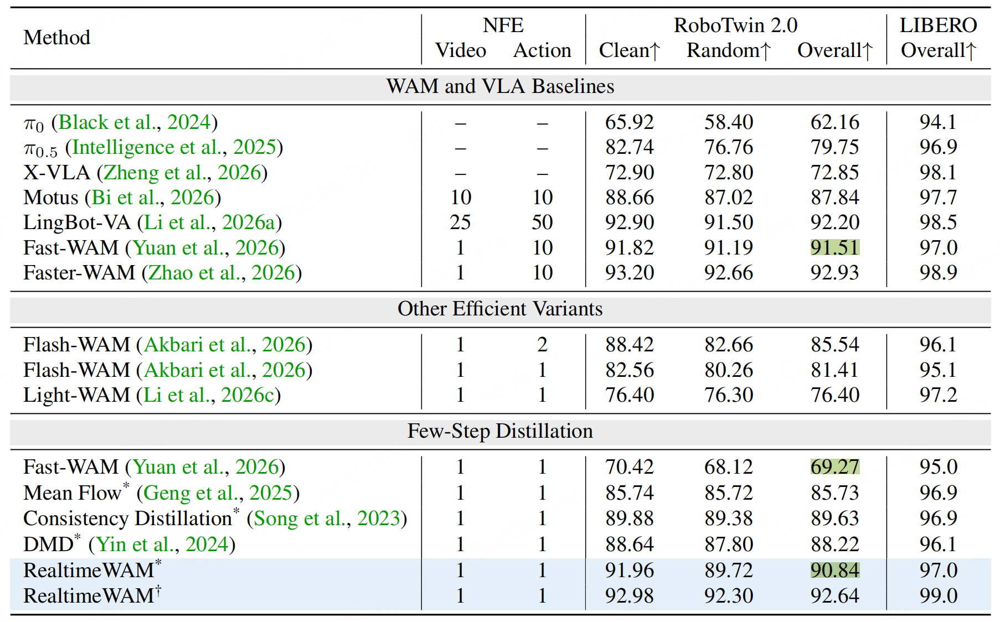
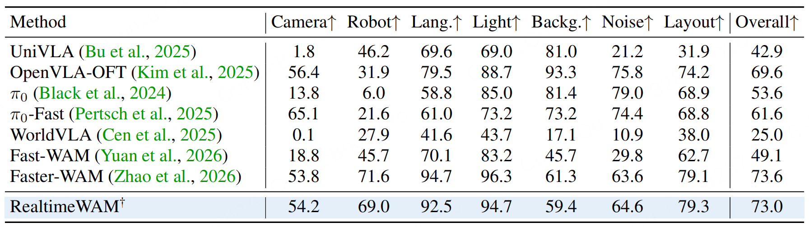

## RealtimeWAM: One-Step Asynchronous World Action Models

> 论文：[arXiv:2610.06617](https://arxiv.org/abs/2610.06617)
> GitHub：[ModelTC/LightX2V — RealtimeWAM](https://github.com/ModelTC/LightX2V/tree/main/scripts/realtimewam)

### 一. 概述

**研究动机**：Fast-WAM、Faster-WAM 等 MoT 架构的 WAM 已经能只计算一次 Video Expert 的表示，再交给 Action Expert 复用，但仍有两个瓶颈：一是**动作分支需要多次 denoising**，二是**动作分支通常要等整个视频分支完成后才启动**。

**核心思想**：用 **Teacher-Anchored Consistency Distillation（TACD）** 同时约束局部 consistency 和多步教师的最终动作，使 Action Expert 一步生成动作；再用 **Cross-Expert Wavefront Pipelining（CEWP）** 按真实依赖逐层共享视频 KV，将两个 expert 的计算重叠。

### 二. 模型方法

#### 1. 基础架构

输入为视觉观测 $o$ 、语言指令 $l$ 及机器人状态，输出为长度为 $H$ 的 action chunk。论文用 $z(o,l)$ 简记共享视觉条件，省略其余条件：

$$
z(o,l)=F_{\psi}^{\mathrm{KV}}(o,l)
=\left\{(K_i^v,V_i^v)\right\}_{i=1}^{N}.
$$

其中 $N$ 是 transformer blocks 的数量， $K_i^v,V_i^v$ 是第 $i$ 个视频 block 产生的 key/value。Action Expert 通过 attention 消费这些条件，原模型多次预测瞬时速度，再数值积分得到动作。

本文的时间方向是纯噪声 $t=1$ → 干净动作 $t=0$ 。从 $t$ 移动到较小的 $s$ 时，Euler 更新为：

$$
a_s\approx a_t-(t-s)v_{\theta}(a_t,t).
$$

RealtimeWAM 保留基座架构，主要改变 Action Expert 的训练目标和两个 expert 的执行时序。论文分别以 Fast-WAM、Faster-WAM 为基座，记作 RealtimeWAM*、RealtimeWAM†。Fast-WAM 推理时省略显式未来视频预测，Faster-WAM 保留该预测。

#### 2. TACD：教师锚点一致性监督

训练时，frozen teacher $\theta_{\mathrm T}$ 、student $\theta_{\mathrm S}$ 和 EMA target $\theta_{\mathrm{ema}}$ 三个 Action Experts 共享冻结 Video Expert 提供的 KV。给定数据动作 $a_0^{\mathrm{data}}$ 和高斯噪声 $\epsilon$ ，构造带噪动作，并用速度预测干净终点：

$$
a_t=(1-t)a_0^{\mathrm{data}}+t\epsilon,
\qquad
f_{\theta}(a_t,t)=a_t-tv_{\theta}(a_t,t).
$$

**局部一致性的不足**：普通一致性蒸馏先让 teacher 从 $t$ 局部更新到相邻的 $s<t$ ，得到 $\tilde a_s$ ，再要求 student 与 EMA 从这两个起点预测的终点一致：
$$
\mathcal L_{\mathrm{CD}}
=\mathbb E\left[
\left\|f_{\theta_{\mathrm S}}(a_t,t)
-\operatorname{sg}\left[f_{\theta_{\mathrm{ema}}}(\tilde a_s,s)\right]\right\|_2^2
\right].
$$

$\operatorname{sg}$ 表示 stop-gradient。但**两个预测彼此一致，不代表它们已经接近准确终点**：student 与 EMA 仍可能一起偏离教师终点，这就是本文关注的 local-global error gap。

**教师终点监督**：从相同的 $a_t$ 、相同条件出发，让 frozen teacher 用 $K$ 步 rollout 积分到 $0$ ，得到教师终点及对应区间平均速度：

$$
a_0^{\mathrm T}=\operatorname{Solver}(a_t,t,0;\theta_{\mathrm T}),
\qquad
u_{\theta_{\mathrm T}}(a_t,t)=\frac{a_t-a_0^{\mathrm T}}{t},
\quad t>0.
$$

保留 CD loss，再直接监督 student 匹配教师的平均速度：

$$
\mathcal L_{\mathrm{TA}}
=\mathbb E\left[
\left\|v_{\theta_{\mathrm S}}(a_t,t)
-\operatorname{sg}\left[u_{\theta_{\mathrm T}}(a_t,t)\right]\right\|_2^2
\right],
\qquad
\mathcal L=\mathcal L_{\mathrm{CD}}+\lambda\mathcal L_{\mathrm{TA}}.
$$

CD 约束“邻近起点预测一致”，TA 则提供“最终应该落在哪里”的参照。TA 等价于按 $1/t^2$ 加权的教师终点 MSE；它约束的是学生对教师终点的偏差，不构成实际任务成功率保证。

#### 3. CEWP：将全专家等待改为消费 KV 前才同步

把第 $i$ 个 block 拆为 Q/K/V projection $\mathcal P_i$ 、attention $\operatorname{Attn}_i$ 和其余计算 $\mathcal R_i$ 。动作 block 的 attention 将视频 KV 与自身 KV 沿 token 维拼接：

$$
\operatorname{Attn}_i^a\left(
Q_i^a,[K_i^v;K_i^a],[V_i^v;V_i^a]
\right).
$$

它真正需要满足的依赖是：

$$
\mathcal P_i^v\longrightarrow\operatorname{Attn}_i^a
\longleftarrow\mathcal P_i^a.
$$

动作 projection 只依赖上一层动作状态，可以先执行；动作 attention 只需等**本层所需视频 KV 就绪**，无需等视频 attention 或整个 Video Expert 完成。

CEWP 使用两个 non-blocking CUDA streams：视频流准备好 KV 后记录 event，并继续自身 attention/后续计算；动作流先做自身 projection，**只在消费视觉 KV 前等待 event**。

> 附录 D 证明：在参数、输入噪声、mask、时间步和算子相同时，CEWP 只是原计算图的另一种合法拓扑排序，**精确算术下输出等价**，无需额外训练，且独立于 TACD。

### 三. 训练流程

#### 1. 数据与可训练部分

- **数据**：RoboTwin 2.0 使用 50 个任务，共 2,500 条 clean 和 25,000 条 randomized demonstrations；LIBERO 使用 Spatial、Object、Goal、Long 四个任务集。
- **冻结部分**：Video Expert、原始教师 Action Expert，以及 student 中未被 LoRA 更新的基座参数。
- **训练部分**：student Action Expert 内 rank-128 LoRA 参数；EMA target 由 student 的滑动平均更新，不通过反向传播优化。
- **共享条件**：一个冻结 Video Expert 计算的 KV 同时服务 teacher、student 和 EMA，避免三者使用不同视觉条件。

#### 2. 单次训练迭代

1. 读取观测、指令、机器人状态及数据 action chunk；计算共享视频 KV。
2. 采样时间和噪声，构造 $a_t$ ，选择相邻时间 $s<t$ 。student 预测速度，并据此得到对应终点。
3. teacher 从 $t$ 局部更新到 $s$ ，EMA 从 $\tilde a_s$ 预测终点，构造 CD target。
4. frozen teacher 从同一个 $a_t$ 做 $K$ 步 $t\to0$ rollout，构造教师终点和平均速度，形成 TA target。
5. 用两项损失之和反向传播，只更新 student LoRA；teacher 和 EMA target 的监督路径均 stop-gradient。
6. 更新 $\theta_{\mathrm{ema}}\leftarrow\mu\theta_{\mathrm{ema}}+(1-\mu)\theta_{\mathrm S}$ 。

#### 3. 超参数与训练开销

| 项目 | 论文设置 |
| --- | --- |
| Teacher rollout 步数 | $K=10$ |
| Teacher anchor 权重 | $\lambda=0.2$ |
| 可训练参数 | Action Expert rank-128 LoRA |
| Optimizer | AdamW |
| 学习率 / weight decay | $10^{-4}$ / $10^{-2}$ |
| 训练迭代 | 30,000 |
| EMA decay | $\mu=0.995$ |

附录 Table A.1 在 **16 张 H100、30,000 iterations** 下报告：

| 训练方案 | Video Expert 是否微调 | 时间 | 峰值 GPU 显存（GiB） |
| --- | --- | ---: | ---: |
| CD | 是 | 8 h 1 min | 65.98 |
| CD | 否 | 5 h 21 min | 24.73 |
| TACD | 否 | 8 h 3 min | 24.73 |

### 四. 推理流程

1. 每个 episode 对语言指令编码一次；每次 policy 调用准备当前观测、机器人状态和所需 latent。
2. 采样动作噪声 $a_1=\epsilon\sim\mathcal N(0,I)$ ，设置 $t=1$ 。
3. 用 CEWP 重叠 Video Expert 和 student Action Expert 的一次 forward；视频条件逐个就绪，动作层按需消费。
4. student 预测区间平均速度，一步得到完整动作 chunk：

   $$
   \hat a_0=\epsilon-v_{\theta_{\mathrm S}}(\epsilon,1\mid z(o,l)).
   $$

5. 按基座策略后处理并执行动作，再获取观测进行下一次规划。

### 五. 实验

#### 1. 实验设置

- **基准与指标**：RoboTwin 2.0 的 Clean / Random、LIBERO 四个 suites、LIBERO-Plus 七类 OOD 扰动，指标均为任务成功率。实机补充为双 PiPER 手臂叠 T-shirt 的定性展示。
- **对比方法**：10-step Fast-WAM / Faster-WAM、直接改为一步的 Fast-WAM、MeanFlow / CD / DMD 蒸馏，以及 Flash-WAM、Light-WAM 等已有方法。
- **比较口径**：作者评测 Fast-WAM、Faster-WAM、蒸馏基线及 RealtimeWAM；部分其他模型结果引用已有论文。
- **Overall**：LIBERO 为四个 suite 的算术平均；RoboTwin 为 Clean 与 Random 的平均；LIBERO-Plus 按各扰动类别的 trial 数加权。
- **延迟**：包含 VAE encoding，排除每个 episode 只执行一次的 text encoding。。

公开 [计时代码](https://github.com/ModelTC/LightX2V/blob/main/lightx2v/models/runners/wan/realtimewam_runner.py#L180) 将动作后处理置于计时范围外，也不包含机器人执行时间，因此该 latency 不是完整机器人控制周期。

#### 2. 实验结果

**（1）主结果：一步保留大部分多步性能。** 下表摘自 Table 1，成功率单位为 %；Video / Action NFE 沿用论文记法。

RoboTwin Overall 相对各自 10-step teacher 分别**下降 0.67 / 0.29 个百分点**；LIBERO Overall 分别**持平 / 提高 0.1 个百分点**。

**（2）OOD：基本保留 Faster-WAM 的扰动鲁棒性。** Table 2 的 LIBERO-Plus 成功率如下，单位为 %。

RealtimeWAM† 的 Overall 下降 0.6 个百分点，部分扰动略升、部分下降。该表没有报告 RealtimeWAM* 的 OOD 结果.

**（3）效率：算法与系统优化贡献需分开。** Figure 5 在单张 H100 上报告的累计优化如下，单位为 ms。

| 累计优化阶段 | Fast-WAM 基座 | Faster-WAM 基座 |
| --- | ---: | ---: |
| 原模型 | 299.7 | 218.9 |
| + TACD | 65.8 (4.56x) | 57.1 (3.83x) |
| + CUDA Graph | 23.3 (2.82x) | 26.2 (2.18x) |
| + CEWP | 17.4 (1.34x) | 22.4 (1.17x) |
| + Efficient kernels | 12.2 (1.43x) | 16.1 (1.39x) |

TACD 单独带来 **4.56× / 3.83×** 加速；在已有 TACD + CUDA Graph 的基础上，CEWP 再带来 **1.34× / 1.17×** 加速。

Table F.3 的完整方案在其他硬件上报告：

| GPU | Fast-WAM 原模型 → 完整方案（ms） | 相对加速 | Faster-WAM 原模型 → 完整方案（ms） | 相对加速 |
| --- | ---: | ---: | ---: | ---: |
| RTX 5090 | 251.5 → 17.8 | 14.1× | 214.1 → 30.9 | 6.9× |
| RTX 4090D | 480.8 → 27.2 | 17.7× | 362.4 → 44.7 | 8.1× |

**（4）消融：anchor、教师步数和 rollout 区间。** 以下均为 RoboTwin 2.0 Overall 成功率（%），来自 Tables 3、4、F.2。

| 损失与训练部分 | Overall |
| --- | ---: |
| CD，微调 Video + Action | 89.63 |
| CD，冻结 Video、只微调 Action | 89.85 |
| TACD，冻结 Video、只微调 Action | 90.84 |

| Teacher rollout steps | Overall | Teacher rollout 区间 | Overall |
| --- | ---: | --- | ---: |
| $K=5$ | 90.39 | $1\to0$ | 90.63 |
| $K=10$ | 90.84 | $t\to r$ ， $r<t$ | 90.23 |
| $K=20$ | 90.77 | $t\to0$ | 90.84 |

在冻结 Video 的消融中，TA 将 Overall 从 89.85% 提高到 90.84%。更多教师步数可以收紧数值积分误差界，但成功率并未随 $K$ 单调提高；默认选 $K=10$ 是性能与教师计算量的折中。

### 六. 局限性

- **适用架构有限**：针对可分离 Video / Action Experts 的 MoT WAM；未直接覆盖 DreamZero 一类 shared-backbone WAM。
- **训练多步成本仍在**：一步发生在推理阶段；TA 仍需要教师 rollout，较 action-only CD 增加约 50% 训练时间。
- **实机证据主要为定性展示**：附录展示 RTX 4090 上双 PiPER 叠衣过程，没有给出实机成功率、重复次数或量化对照，尚不足以证明广泛实机泛化。
