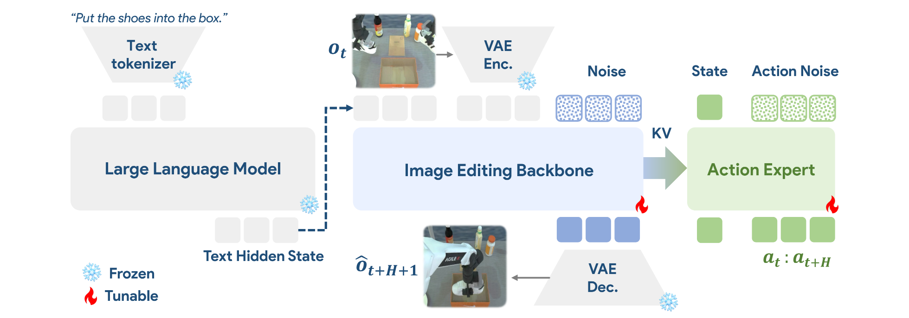
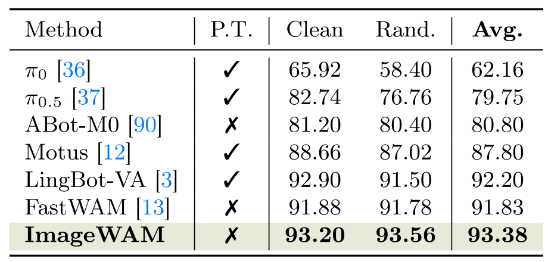
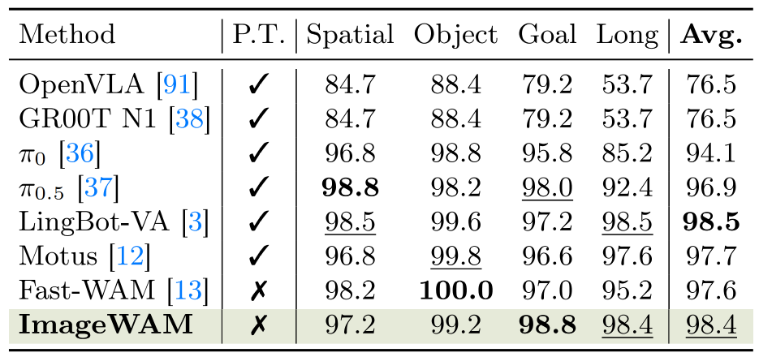
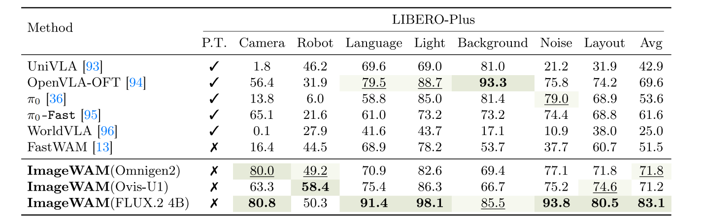
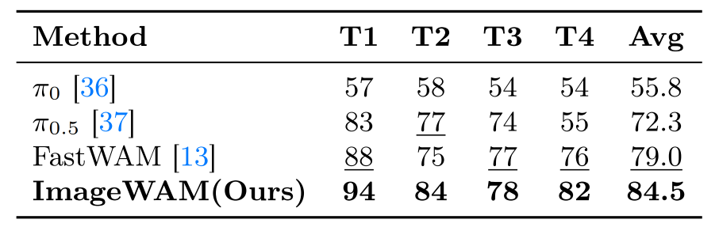
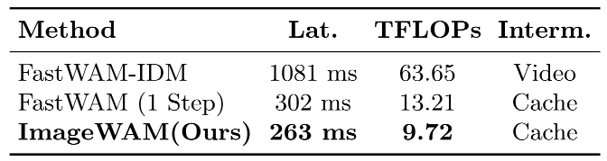
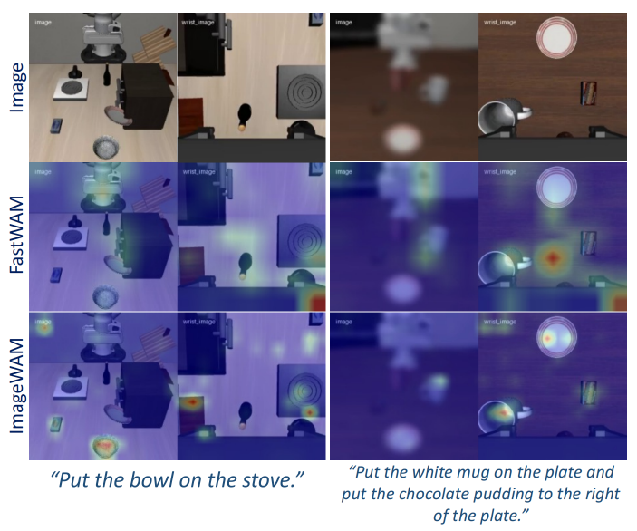

## ImageWAM: Do World Action Models Really Need Video Generation, or Just Image Editing?

> 论文：[arXiv:2606.19531](https://arxiv.org/abs/2606.19531)
> 项目：[Project Page](https://zhangwenyao1.github.io/ImageWAM/)
> GitHub：[yuyangalin/ImageWAM](https://github.com/yuyangalin/ImageWAM)

### 一. 工作动机

**研究动机**：视频生成可以为 World Action Model（WAM）提供世界建模先验，但密集的未来视频 tokens 会增加开销，特别是 IDM 式视频生成路径还需要先生成未来视频，再据此预测动作，开销更大。

**关键矛盾**：机器人控制需要关注任务相关的物体运动和空间关系，是否必须显式建模完整的多帧视觉过程？

**核心思想**：ImageWAM 用预训练图像编辑 (image editing) backbone 替代视频生成 backbone，通过未来端点图像预测与动作预测联合训练，迁移指令驱动的视觉变化先验。训练仍保留未来图像监督，但部署不要求输出图像：视觉前向提供中间 KV，action expert 再生成 action chunk。

---

### 二. ImageWAM 方法



#### 2.1 Image Editing Backbone

ImageWAM 可基于 OmniGen2、Ovis-U1 和 FLUX.2 等预训练 image editing model 构建。训练时，模型输入包括语言指令、干净当前观测、带噪未来目标图像 latent，以及带噪 action chunk；本体状态按具体配置使用。未来目标是**当前 action chunk 对应的端点帧**，不一定是整个任务完成后的最终画面。论文实验使用未来 16 帧处的观测，动作片段长度也为 16。

#### 2.2 MoT 与注意力范围

图像扩散分支与 action expert 通过 Mixture-of-Transformers（MoT）逐层联合计算：各自生成 QKV，执行带 mask 的联合 attention，再分别更新各自特征。当前公开主线的 Prefix-Only mask 如下（prefix 包括文本、当前观测和状态 tokens）：

| Query tokens | 可读取的 Key / Value tokens |
| --- | --- |
| prefix | prefix |
| 未来图像 | prefix + 未来图像 |
| 动作 | prefix + 动作自身 |

> 关于文本和状态的处理，ImageWAM 和 FastWAM 有一些区别：
>
> * **ImageWAM**：**将状态、文本和当前观测共同组成 prefix**。动作 tokens 通过 joint attention 读取 prefix。推理时，先计算并缓存各层 prefix KV，再供动作分支使用。
>
> * **FastWAM**：**将状态追加到文本序列，组成独立的条件 context**。Video 和 Action 分支先进行 self/joint attention，再分别通过 cross-attention 读取文本和状态。文本与状态在 DiT 内只提供 K/V，不作为 Q，也不被注意力更新。推理时，动作分支既读取视觉 KV Cache，也继续单独对文本和状态做 cross-attention。

#### 2.3 Action Expert 与 KV Cache

Action expert 用 Flow Matching 预测动作速度场，生成连续的 action chunk。在 Prefix-Only 推理中，先执行视觉前向，缓存各层 prefix K/V，供动作去噪重复使用：

$$
C_{\mathrm{prefix}}=\{(K_l^{\mathrm{prefix}},V_l^{\mathrm{prefix}})\}_{l=1}^{L}
$$

其中 $L$ 为层数。这个缓存是模型的中间特征，不是已经生成或解码的未来图像；其具体可见范围由 attention mask 决定。

---

### 三. 训练与推理

#### 3.1 训练目标与流程

设 $z^\ast$ 为端点图像 latent， $a^\ast$ 为真实 action chunk， $\epsilon_z,\epsilon_a$ 为高斯噪声。图像时间 $r$ 与动作时间 $s$ 分别采样，均约定 **0 为数据、1 为噪声**，避免与环境时间 $t$ 混淆：

$$
z_r=(1-r)z^\ast+r\epsilon_z,\qquad a_s=(1-s)a^\ast+s\epsilon_a.
$$

图像分支和动作专家分别预测速度，监督目标为：

$$
u_z=\epsilon_z-z^\ast,\qquad u_a=\epsilon_a-a^\ast.
$$

两项 Flow Matching 损失分别约束未来图像与动作的速度预测：

$$
\mathcal L_{\mathrm{img}}=\mathbb E\lVert v_{\mathrm{img}}-u_z\rVert^2,\qquad
\mathcal L_{\mathrm{act}}=\mathbb E\lVert v_{\mathrm{act}}-u_a\rVert^2.
$$

$$
\mathcal L=\lambda_{\mathrm{img}}\mathcal L_{\mathrm{img}}+\lambda_{\mathrm{act}}\mathcal L_{\mathrm{act}}.
$$

公开基础配置的权重为图像 0.5、动作 1.0。生成时沿对应速度场从 1 向 0 积分。

```text
指令 + 干净当前观测 + 带噪端点图像 + 带噪 action chunk
→ MoT 逐层联合前向（分别计算 QKV → masked joint attention → 分别更新）
→ 分别预测图像／动作 velocity，计算两项损失
→ 加权求和，联合反向传播
```

VLM／多模态理解模块冻结，图像扩散分支和 action expert 参与训练。训练不是先完整运行图像分支，再完整运行动作分支的串行流程。图像加噪只作用于未来目标，当前观测保持干净。但沿用的 image editing backbone 共享随机 image timestep embedding，因此当前观测特征也受该时间条件调制。共享时间条件不等于当前观测被加噪。

#### 3.2 推理流程

当前公开默认的 **Prefix-Only 动作推理**：

```text
当前观测 + 指令（不创建未来图像噪声 tokens，image 时间条件固定为 0）
→ 一次视觉前向，建立 prefix KV cache
→ action expert 读取缓存，从动作噪声出发多步去噪（s: 1 → 0）
→ 输出 action chunk
```

这一流程无需未来图像去噪或图像解码。不创建未来 tokens、image 时间为 0 的结论仅限此 Prefix-Only 路径，不能套用于论文全部配置。论文还报告了保留未来视觉 tokens、单步视觉处理后再进行动作去噪的配置，效率比较见 4.5。

---

### 四. 实验

论文在 RoboTwin 2.0、LIBERO、LIBERO-Plus 和真实双臂机器人上评估 ImageWAM。没有额外的 embodied policy pretraining，不等于没有使用预训练模型：模型仍继承了预训练 image editing backbone。

#### 4.1 RoboTwin 2.0

本文采用 RoboTwin 2.0 的 **50 任务设置**，在 Clean／Randomized 条件下评估双臂操作。



ImageWAM 在该设置下超过 FastWAM 及表中的部分 VLA/WAM baseline。

#### 4.2 LIBERO

LIBERO 包含 Spatial、Object、Goal 和 Long 四个 suite，覆盖空间关系、物体、目标及长程任务。



ImageWAM 在 Long suite 上表现较好；结果支持其在长程任务中的有效性，但不能单凭该结果确定具体机制。

#### 4.3 LIBERO-Plus

LIBERO-Plus 加入 camera、robot、language、light、background、noise、layout 等扰动。使用原始 LIBERO demonstrations 训练后评估这些扰动，不以扰动增强数据重新训练。



不同 backbone 的鲁棒性存在差异，FLUX.2 4B／9B 版本在此评估中表现更强。

#### 4.4 真实机器人实验

使用 Dobot XTrainer 双臂平台，包含 Stack Three Bowls、Fold Towel、Open Drawer & Store Marker、Hang Cup On Rack 四个任务。



ImageWAM 的平均成功率超过 FastWAM，表明其效果也体现在真实机器人任务上。

#### 4.5 效率分析



论文 Table 11 区分了以下配置，**均使用 3 个动作去噪步**：

| 方法 | 视觉输入／处理配置 | 延迟 |
| --- | --- | --- |
| FastWAM | 保留未来视频 tokens，单步视觉处理 | 302 ms |
| ImageWAM | 保留未来目标图像 tokens，单步视觉处理 | 263 ms |
| FastWAM | 移除未来视觉 tokens，Prefix-Only | 194 ms |
| ImageWAM | 移除未来视觉 tokens，Prefix-Only | 198 ms |

#### 4.6 Attention 可视化



可视化显示 attention 更集中于操作物体、目标容器等任务相关区域。它支持“更关注任务相关区域”。

---

### 五. 局限性与思考

1. **Backbone 与部署成本**：不同 image editing backbone 的结果存在差异；即使不解码图像，仍需运行视觉分支，大模型的部署成本需要结合具体配置比较。
2. **个人思考：中间动力学**。端点图像监督不显式约束完整视觉过程，是否足以覆盖精细接触、连续动力学和时序约束，仍需专门实验验证。
